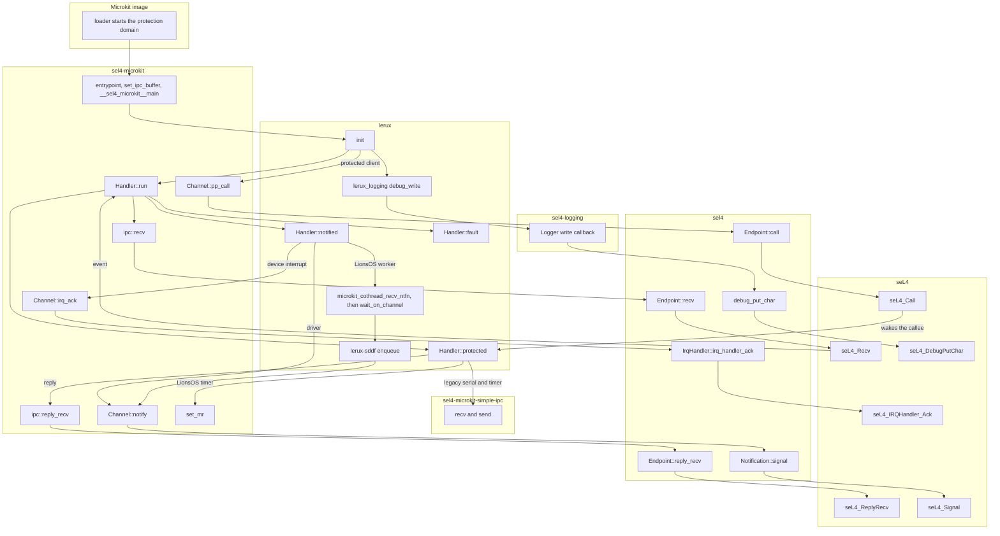

# Architecture

lerux protection domains are `#![no_std]` Rust crates. They link [rust-sel4](https://github.com/seL4/rust-sel4) `v5.0.0` for the userspace runtime and call the seL4 kernel through that runtime. The [Microkit](https://github.com/seL4/microkit) `2.3.0` tool builds `loader.img` from the system description and those ELF files, and its software development kit supplies the libsel4 headers. The kernel is upstream seL4 `16.0.0`.

`sel4-microkit` is the Rust implementation of the Microkit protection-domain runtime. It uses the capability slot numbers the Microkit tool assigns and issues seL4 system calls itself. The pins are the workspace git dependencies in the root `Cargo.toml` and the same tag in `deps/versions.toml`. Domain language is in [context.md](context.md).

`sel4-sync` is declared in the workspace dependencies. No member crate depends on it.

## Dependency hierarchy

The host graph is how an image is assembled. The guest graph is which crates a protection domain links. `lerux-sddf`, `lerux-cothread`, and `lerux-posix` sit in the guest and have no rust-sel4 dependency. `lerux-cothread` is the Rust port of `libmicrokitco` and switches stacks inside the one kernel thread.

```mermaid
flowchart TB
  subgraph host [Host assembly]
    cli["lerux-cli"]
    elfs["protection-domain ELF files"]
    tool["Microkit tool"]
    cli --> elfs
    cli --> tool
    elfs --> tool
  end

  subgraph guest [Guest crates]
    allPds["every protection domain"]
    lionsVirtio["sddf-blk-driver, sddf-net-driver, sddf-gpu-driver"]
    lionsSerial["sddf-serial-driver"]
    legacy["virtio-blk-driver, virtio-net-driver, virtio-pci-driver, http-server, hello"]
    boardDrv["serial-driver, console-driver, sp804-driver, pl031-driver, emmc2-driver, genet-driver, real-time clock drivers"]
    logging["lerux-logging"]
    protocols["lerux-driver-protocols"]
    vhal["lerux-virtio-hal"]
    localOnly["lerux-sddf, lerux-cothread, lerux-posix"]
  end

  subgraph rustSel4 [rust-sel4 v5.0.0]
    mk["sel4-microkit"]
    mkBase["sel4-microkit-base"]
    mkRuntime["sel4-runtime-common, sel4-panicking, sel4-dlmalloc"]
    sel4crate["sel4"]
    sel4sys["sel4-sys"]
    loggingUp["sel4-logging"]
    pl011["sel4-pl011-driver"]
    timers["sel4-sp804-driver, sel4-pl031-driver"]
    drvIf["sel4-driver-interfaces"]
    adapters["sel4-microkit-driver-adapters"]
    simple["sel4-microkit-simple-ipc"]
    rings["sel4-shared-memory, sel4-shared-ring-buffer, block-I/O and smoltcp rings"]
    virtioWrap["sel4-virtio-blk, sel4-virtio-net"]
    hal["sel4-virtio-hal-impl"]
    alloc["sel4-abstract-allocator"]
    once["sel4-immediate-sync-once-cell"]
  end

  subgraph platform [Platform]
    sdk["Microkit SDK libsel4 headers"]
    kernel["seL4 kernel"]
  end

  allPds --> mk
  allPds --> localOnly
  lionsVirtio --> hal
  lionsVirtio -->|"x86 Peripheral Component Interconnect"| vhal
  lionsSerial -->|"aarch64"| pl011
  lionsSerial -->|"x86 port input and output"| sel4crate
  lionsSerial --> drvIf
  legacy --> virtioWrap
  legacy --> rings
  legacy --> adapters
  legacy --> alloc
  legacy --> drvIf
  boardDrv --> adapters
  boardDrv --> simple
  boardDrv --> pl011
  boardDrv --> timers
  boardDrv --> drvIf
  logging --> loggingUp
  logging --> sel4crate
  logging -->|"serial feature"| mk
  logging -->|"serial feature"| adapters
  protocols --> simple
  protocols --> drvIf
  protocols --> mk
  vhal --> alloc
  vhal --> rings
  vhal --> once

  mk --> mkBase
  mk --> mkRuntime
  mk --> sel4crate
  mkBase --> sel4crate
  simple --> mkBase
  adapters --> mk
  virtioWrap --> drvIf
  pl011 --> drvIf
  timers -->|"sp804"| drvIf
  hal --> alloc
  hal --> rings
  hal --> once
  sel4crate --> sel4sys
  sel4sys --> sdk
  sdk --> kernel
  tool --> kernel
```

`sel4-virtio-hal-impl` is the memory-mapped virtio hardware abstraction on the LionsOS drivers. `lerux-virtio-hal` replaces it on the x86 Peripheral Component Interconnect builds of those drivers, and on `virtio-pci-driver`. The legacy virtio crates (`sel4-virtio-blk`, `sel4-virtio-net`) and the shared ring buffers stay on the hello, virtio, and HTTP boards. LionsOS queues live in `lerux-sddf`.

`sel4-microkit-simple-ipc` and `lerux-driver-protocols` carry the postcard protected-procedure messages for `serial-driver`, `console-driver`, and the timer protocol those adapters still speak. The LionsOS timer protection domain uses message registers directly.

An edge out of a group is the union of that group's direct dependencies. `sel4-microkit-base` is the rust-sel4 crate on the path to `sel4`. `lerux-logging` also depends on `sel4` directly, for `debug_print!`. `sel4-logging`, the ring-buffer crates, `sel4-virtio-hal-impl`, `sel4-virtio-blk`, and `sel4-virtio-net` are libraries beside that path.

The `serial` feature of `lerux-logging` is the optional edge to `sel4-microkit` and `sel4-microkit-driver-adapters`. `sel4-pl011-driver` on `sddf-serial-driver` is aarch64-only. The x86 build of that driver depends on `sel4` for the port input and output path. `sel4-shared-ring-buffer-block-io` and `sel4-shared-ring-buffer-bookkeeping` are the optional virtio feature of `hello`.

## Function call graph

One protection domain has one kernel thread. `Handler::run` in `sel4-microkit` is that thread's loop. A LionsOS worker blocks by switching stacks in `lerux-cothread`. That switch stays inside the protection domain. The resumed worker's next system call is usually `Channel::notify`.

`entrypoint` comes from `sel4-runtime-common`. The `#[protection_domain]` attribute generates `__sel4_microkit__main`, which calls the lerux `init` function and then `Handler::run`. Before the loop, `Handler::run` acknowledges each bound interrupt. `ipc::recv` waits on the input endpoint in capability slot 1. The badge distinguishes a notification, a protected procedure, and a child fault. Those three arms call `Handler::notified`, `Handler::protected`, and `Handler::fault`.

`Channel::notify` signals the notification capability Microkit placed in the sender's capability space. `Channel::pp_call` is `seL4_Call` on the endpoint for that channel. The callee writes reply words with `set_mr` or with `sel4-microkit-simple-ipc`, returns a `MessageInfo`, and `Handler::run` sends it with `seL4_ReplyRecv`. `debug_write` is the `sel4-logging` sink installed by `lerux_logging::debug::init`. It prints through `seL4_DebugPutChar`.

On a LionsOS shell, agent, or filesystem server, the root `Handler::notified` resumes a cothread. The worker enqueues a `lerux-sddf` queue entry and notifies the other protection domain. Device drivers notify from `Handler::notified` on the root, and the virtio drivers call `HalImpl::init` from `init` before that loop starts.
