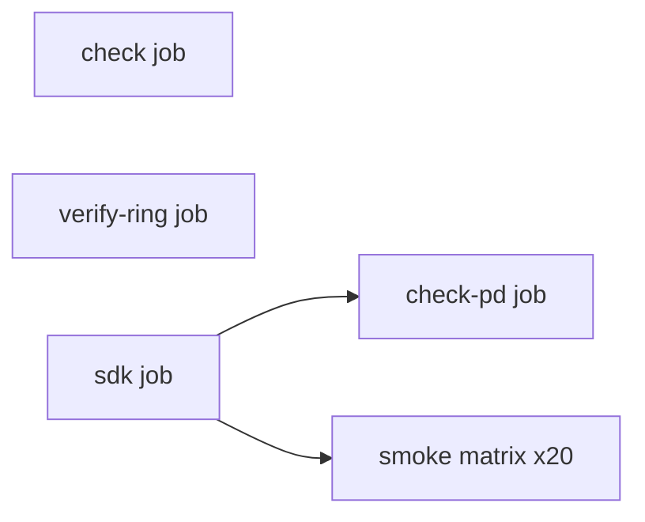

# CI and local smoke tests

GitHub Actions workflow: [`.github/workflows/rust.yml`](../.github/workflows/rust.yml).

## Pipeline

1. **check** — `just check` (`cargo fmt --all --check` + clippy on host crates; no SDK).
2. **sdk** — Docker image, fetch sources, build Microkit SDK (cached), **prebuild patched SP804 QEMU** (cached), upload SDK artifact.
3. **check-pd** — `just check-pd` (cross-target clippy on PD + shared userspace crates; needs SDK artifact).
4. **smoke** — 20 parallel matrix jobs; each restores SDK artifact and per-job `build/` cache. Serial captures land in `build/smoke-logs/` and upload as `smoke-serial-<id>` (Phase 57).
5. **verify-ring** — `just verify-ring`. Proves `lerux-ring` with the pinned Verus release. Runs in parallel with check and does not need the SDK. Its target directory is `build/verus`.



Local mirror: `just check` (format + clippy for host crates, plus `lerux profile check-qos`); `just check-pd` after `just build-sdk` (or `just check-all` for both).

`just test-all` runs every board with `ci = true`. The jobs in the table below are the workflow `include` list. Those two sets are not the same. `cargo test -p lerux-cli -- ci_lists` fails when a count on this page or in the README disagrees with the include list, when a workflow board has `ci = false`, or when a board in either set below is missing from this page. A new board name is compiled with `--features board-<name>` only when the PD crate declares that feature.

**Security pin bumps** (seL4 / Microkit / rust-sel4): follow the Phase 60 Track B runbook in [`security.md`](security.md#dependency-pins-and-security-update-runbook-track-b) — pin edit → SDK refresh → check / check-pd → smoke matrix → rebuild images.

**QoS (Track D):** `lerux profile check-qos` is part of `just check`. Guest concurrent-boot signal is `lerux-shell: qos ok` on workstation smokes ([`qos.md`](qos.md#abuse-tests-phase-60-track-d)).

## Smoke matrix

| Job ID | Command | Notes |
|--------|---------|-------|
| `aarch64` | `BOARD=qemu_virt_aarch64 just test` | Serial hello on virt |
| `x86_64` | `BOARD=x86_64_generic just test` | COM1 serial |
| `riscv64` | `just test-riscv` | NS16550 MMIO |
| `virtio` | `just disk-img && just test-virtio` | aarch64 virtio blk/net + TCP RX |
| `cothread` | `just test-cothread` | aarch64 worker blocks on a Microkit notification and resumes |
| `serial-sddf` | `just test-serial-sddf` | aarch64 serial driver, transmit virtualiser, receive virtualiser, and one client |
| `fs-sddf` | `just test-fs-sddf` | aarch64 block driver, serial driver, block and serial virtualisers, File Allocation Table server, and shell. |
| `net-sddf` | `just test-net-sddf` | aarch64 network driver, serial driver, network and serial virtualisers, one copier, and a smoltcp client |
| `fetch-sddf` | `just test-fetch-sddf` | aarch64 filesystem and network roles; the shell fetches the https-one fixture |
| `web-sddf` | `just test-web-sddf` | aarch64 filesystem and network roles; the shell serves the seeded hostname file |
| `browser-sddf` | `just test` | aarch64 filesystem, network, and graphics roles; the shell prints a browser and maths menu, paints the fixture, then evaluates `(1+2)*3`. Bare `just test` is this smoke. |
| `agent-sddf` | `just test-agent-sddf` | aarch64 filesystem and network roles; grok asks the agent to write and read a file |
| `program-sddf` | `just test-program-sddf` | aarch64 filesystem and network roles; a signed WebAssembly module reads the hostname and allocates a socket |
| `html` | `just test-html` | Phase 74: lerux-html subset parser (`lerux-html: nodes=8`) |
| `riscv-virtio` | `just disk-img && just test-riscv-virtio` | RISC-V virtio |
| `http` | `just test-http` | virtio-net HTTP `GET /` via hostfwd |
| `x86-http` | `just test-x86-http` | x86 q35 PCI virtio-net HTTP via hostfwd |
| `x86-console` | `just test-x86-console` | q35 VGA text menu; PS/2 keys choose maths and evaluate `6/2` |
| `riscv-http` | `just test-riscv-http` | RISC-V MMIO virtio-net HTTP via hostfwd |
| `x86-virtio` | `just disk-img && just test-x86-virtio` | x86 q35 PCI virtio-blk/net + TCP RX |

Local mirror: `just test-all` (requires full SDK; creates `support/disk.img` once).

## Hardware serial smoke (Phase 47)

Expect strings live in **`support/smoke-expects.toml`** (shared by QEMU and hw-serial).  
Test modes for `lerux test`:

| Mode | Flag / env | Behaviour |
|------|------------|-----------|
| `auto` (default) | `--mode auto` or unset | QEMU boards → QEMU; hardware boards → hw-serial **if** `LERUX_HW_SERIAL` is set, else image-only success |
| `qemu` | `--mode qemu` | Force QEMU (fails on hardware-only boards) |
| `hw-serial` | `--mode hw-serial` or `LERUX_TEST_MODE=hw-serial` | Read serial device; requires `LERUX_HW_SERIAL` |

**Golden path (RPi4 workstation):**

```bash
# 1. Deploy loader.img to SD boot (Phase 52)
DEST=/media/$USER/boot just deploy-rpi4
# 2. U-Boot: fatload mmc 0 0x10000000 loader.img; go 0x10000000
# 3. Host smoke (serial free — not held by screen):
BOARD=rpi4b_4gb_workstation LERUX_HW_SERIAL=/dev/ttyUSB0 just test-hw
#    → boot expects + scripted ls/pwd/ip from support/smoke-expects.toml
```

Optional env:

| Variable | Default | Purpose |
|----------|---------|---------|
| `LERUX_HW_SERIAL` | (required for hw-serial) | TTY path, e.g. `/dev/ttyUSB0` |
| `LERUX_HW_BAUD` | `115200` | Serial baud |
| `LERUX_HW_LOCK_DIR` | `$TMPDIR/lerux-hw-locks` | Advisory lock directory (single-writer) |
| `LERUX_HW_LOCK_WAIT_SECS` | `300` | Wait for lock |
| `LERUX_TEST_MODE` | `auto` | Same as `--mode` |

Locks prevent two local jobs from racing the same board (`{board}.lock` with PID; stale locks are stolen if the PID is gone).

### Self-hosted CI workflow

Workflow: [`.github/workflows/hw-serial.yml`](../.github/workflows/hw-serial.yml) (`workflow_dispatch` only).

1. Runner labels: `self-hosted`, `lerux-hw`
2. Repo variable `LERUX_HW_ENABLED=true` (job is skipped otherwise — no infinite queue on github-hosted)
3. Repo variable `LERUX_HW_SERIAL` (device path on the runner)
4. Optional `LERUX_HW_BAUD`

Cloud PR smoke **does not** require a Pi. Hardware remains an opt-in lab path.

## In test-all, outside the workflow

These boards have `ci = true`, so `just test-all` runs them. They are not in the GitHub include list.

- `qemu_virt_aarch64_debug`
- `qemu_virt_riscv64_debug`
- `x86_64_generic_debug`

## Waiting on a smoke

These boards have `ci = false`. Milestone 16 added the QEMU RISC-V and QEMU x86 device-framework boards in this list. Each board joins the workflow only after `just check`, `just check-pd`, and that board's smoke have passed, in the same change as the include list and the handwritten counts. Marking the milestone done does not put the board in continuous integration. `rpi4b_4gb` and `pc_z97_d3h_rtl8852be` stay here until a hardware runner is the smoke.

- `pc_z97_d3h`
- `pc_z97_d3h_rtl8852be`
- `qemu_virt_riscv64_agent_sddf`
- `qemu_virt_riscv64_browser_sddf`
- `qemu_virt_riscv64_cothread`
- `qemu_virt_riscv64_fetch_sddf`
- `qemu_virt_riscv64_fs_sddf`
- `qemu_virt_riscv64_net_sddf`
- `qemu_virt_riscv64_program_sddf`
- `qemu_virt_riscv64_serial_sddf`
- `qemu_virt_riscv64_web_sddf`
- `rpi4b_4gb`
- `swift_sfx14_41g`
- `x86_64_generic_agent_sddf`
- `x86_64_generic_fetch_sddf`
- `x86_64_generic_fetch_native`
- `x86_64_generic_fs_ahci`
- `x86_64_generic_fs_sddf`
- `x86_64_generic_net_e1000e`
- `x86_64_generic_net_sddf`
- `x86_64_generic_program_sddf`
- `x86_64_generic_serial_sddf`
- `x86_64_generic_web_sddf`

## Caches

| Cache | Key inputs | Restored in |
|-------|------------|-------------|
| Workspace | `deps/versions.toml`, `tools/lerux-cli` | sdk |
| SDK | versions + `SDK_CACHE_SUFFIX` | sdk |
| SP804 QEMU | patch + `install-qemu-sp804.sh` | sdk (build), smoke init/composed/blk-composed/http-composed/net-composed/ipc-composed/workstation (restore) |
| Shared `build/target/` | `Cargo.lock` | check-pd, smoke (all jobs) |
| Per-smoke `build/<board>/` | `Cargo.lock` + matrix job id | smoke |

SP804 QEMU is built once in the **sdk** job so `init`, `composed`, `blk-composed`, `http-composed`, and `net-composed` do not each cold-build QEMU (~4 min). Cache paths include install prefix, source tree, and tarball.

Caches are saved with `if: always()` when the artifact exists, so a failing smoke job still retains partial `build/` and a completed QEMU install.

## Patched QEMU

Stock QEMU `virt` lacks SP804 at `0x90d0000`. Init, composed, blk-composed, http-composed, and net-composed smokes use `cargo run -p lerux-cli -- install sp804-qemu`. The installer prints **only** the install `bin` directory on stdout (build logs go to stderr).

## Troubleshooting

| Symptom | Likely cause |
|---------|----------------|
| `Argument list too long` on `python3` | Corrupted `PATH` from capturing QEMU build stdout — fixed in SP804 installer stderr/stdout split |
| Init passes, timer times out | Stock QEMU used instead of patched build — check `which qemu-system-aarch64` |
| Composed flaky on `init ok` | Serial/debug interleaving — `supervisor` notifies `hello` before virtio (composed-sync) |
| ipc-composed times out on `virtio-net: MAC` | Concurrent `debug_putchar` splices mid-line (`virtio-` / `net: MAC`, or `vir` / `512` / `tio-net: MAC` / ` bytes`). Smoke matching reconstructs unfinished `INFO [target]` lines as a FIFO so nested splices (and an earlier split prefix) do not steal leftovers |
| isolation times out on `lerux-debug: ready` | `INFO  [serial_driver]INFO  [debug_handler]` with serial's payload on the debug line. Matcher treats `]INFO` as a prefix boundary and pairs the first newline with the preempted prefix-only line |
| `x86-http`: serial shows `listening`, `curl` times out | Stale QEMU or `tcp-echo-server` on host **18080** — see [boards.md — x86 HTTP inbound](boards.md#x86-http-inbound-operational-notes); smoke recipe kills both before start |
| `x86-http`: QEMU idle at `listening` | Expected until host `curl` — guest waits on driver notifications; use `just test-x86-http` or curl from another terminal |
| `x86-virtio` fails `TCP RX ok` after `x86-http` | Usually port **18080** still in use; kill stale QEMU/echo server, rerun virtio test |
| Piping `just test … \| tail` shows no output then SIGTERM | `tail` buffers until the command exits; run smoke tests without `tail` when debugging |
| `libglib2.0-dev` missing locally | Install build deps or use Docker (`lerux-dev` image) |