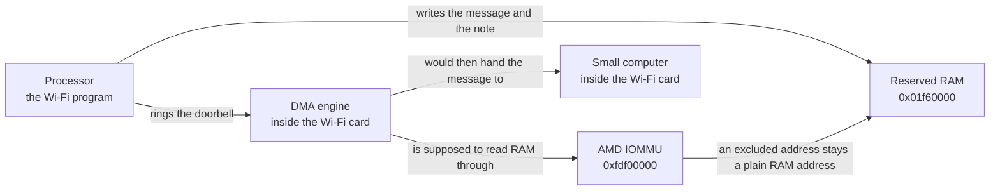

# What the Swift boot screen is showing

This is a guide to the Acer Swift X boot you have been watching. It explains the words on the screen, the parts of the machine they name, and the one job that is stuck.

The laptop reaches the menu, then sits there. Wi-Fi, the disk, and Bluetooth are supposed to print a status line each. Those lines take about a minute to appear. The minute is one program waiting for the Wi-Fi card to pick up a message. The card has not picked it up. The short lines on the screen are that wait, written out so the machine does not look frozen.

You do not need a background in drivers or operating systems to follow this. Each section says where a thing lives, what shape it has, and why this boot uses it.

## The four places

Four parts of the laptop are involved. They are separate objects, and a word on the screen always belongs to one of them.

**The processor** is the AMD chip that runs lerux. One of its programs is the Wi-Fi starter. That program can write bytes into RAM, and it can write the Wi-Fi card's control registers. It cannot itself carry a message into the card. It can only leave the message in RAM and ask the card to come and get it.

**The reserved RAM** is a 256 KiB patch of ordinary memory, starting at physical address `0x01f60000`. "Physical" means the address the memory chips use, the same number a device puts on the wires when it wants those bytes. The Wi-Fi program and the Wi-Fi card are both supposed to use this patch. The message sits here. The note that describes the message sits here too.

**The AMD IOMMU** is a translator that sits between plug-in devices and RAM. Its registers live at `0xfdf00000`. When the Wi-Fi card asks to read address `0x01f66000`, that request passes through this translator. The translator can turn the address into a different RAM address, or it can let the address through unchanged. The screen line `excl` is a reading of this translator's settings.

**The Wi-Fi card** is a MediaTek MT7921, on the internal PCI bus at `03:00.0`. Inside that card are two pieces that matter here:

- A DMA engine, called WFDMA on the screen. DMA means the card reads and writes RAM by itself, without the processor copying each byte. The labels `wfdma: doorbell` and `wfdma: fetch` name this engine.
- A small computer, the MCU. At power-on it runs a program stored in ROM, a chip that keeps its contents with the power off. That ROM knows how to accept a firmware download. It does not go looking in host RAM. It waits until the DMA engine has copied a message in.

The screen you are reading is a fifth place, only as a display. A shared picture of the panel lives in memory at `0xfc90000000`. The Wi-Fi program paints text into that picture. The IOMMU leaves the display path translated, which means the screen's own memory is handled separately from the Wi-Fi patch of RAM.

## Who paints, and why the machine looks stuck

lerux runs several small programs at once. Each one has its own memory. They share the picture of the screen, and each one is told which rows it may write. A higher priority number means that program's startup runs to the end before the next program starts.

| Priority | Program | What it paints |
| --- | --- | --- |
| 6 | Display | `hello lerux` and, later, the menu |
| 5 | PCI probe | Device names below the menu, and rows 15 and 16 |
| 4 | Wi-Fi | Rows 13, 14, and 17–22 |
| 3 | Disk | Row 23, `nvme` |
| 2 | Bluetooth | Row 24, `bt` |
| 1 | Menu | `1 browser`, `2 maths`, `3 wifi` |

The Wi-Fi program starts before the disk program and the Bluetooth program. Its startup includes a long wait for the card. Until that wait ends, the disk line and the Bluetooth line do not exist yet. The blank minute is that wait. The moving dots, and the lines under them, are there so the wait is visible.

A later scroll of the menu redraws the whole picture from the menu's own record of the screen. That record does not contain rows 13–21. A full redraw erases them. The status word on row 22 is painted again by the Wi-Fi program, so it survives.

## How to read the numbers

The screen prints numbers in hexadecimal. That is base 16. The digits are `0`–`9` and then `a`–`f` for ten through fifteen. There is no room on a row for the usual `0x` prefix, so `b2000` means the same thing as `0x2000`.

A few values are worth knowing by sight:

| On screen | Value | In ordinary numbers |
| --- | --- | --- |
| `10` | `0x10` | 16 |
| `0100` | `0x100` | 256 |
| `1000` | `0x1000` | 4096, one memory page |
| `2000` | `0x2000` | 8192 |
| `01f66000` | `0x01f66000` | the address of the message tray |

A page is 4096 bytes. The IOMMU and the descriptor ring both count in pages. `256 × 16 = 4096`, so a ring of 256 descriptors fills exactly one page.

## The reserved RAM, shelf by shelf

The patch starts at `0x01f60000` and is `0x40000` bytes long, which is 256 KiB. It ends at `0x01fa0000`. Everything the card is asked to read for this startup lives inside it. Offsets below are added to `0x01f60000`.

| Offset | Address | What is stored there |
| --- | --- | --- |
| `0x0000` | `0x01f60000` | A transmit ring used for ordinary frames |
| `0x1000` | `0x01f61000` | The ring used to send firmware chunks |
| `0x2000` | `0x01f62000` | The ring used to send commands to the small computer. This is the ring in the stuck boot |
| `0x3000` | `0x01f63000` | A ring the card uses to send replies back |
| `0x6000` | `0x01f66000` | The bounce buffer, the tray that holds the current message |

The bounce buffer is one reusable tray, 4096 bytes long. The processor copies a message into it, tells the card the tray's address, and waits. The same tray is used again for the next message only after the card has taken the previous one. On this boot the first message is still sitting in the tray.

Neighboring patches of the same kind of reserved RAM belong to other devices. The disk uses `0x01f00000`. Bluetooth's USB controller uses `0x01f20000`. The Wi-Fi patch is `0x01f60000`. The IOMMU setting described later covers all three, from `0x01f00000` through `0x01fa0000`.

## A descriptor

A descriptor is a 16-byte note in RAM. It is how the processor tells the card's DMA engine about one message. The note is not the message. The message is the bounce buffer. The note says where the message is, how long it is, and whether the card has finished with it.

The command ring holds 256 of these notes, packed one after another at `0x01f62000`. Note number 0 occupies the first 16 bytes. Note number 1 occupies the next 16, and so on. The stuck boot is about note 0.

Each note is four 4-byte numbers, stored least-significant byte first, which is the normal layout for this processor:

| Bytes | Name | This boot |
| --- | --- | --- |
| 0–3 | Address of the message | `0x01f66000`, the bounce buffer |
| 4–7 | Control word | Length, a "last piece" mark, and a done bit |
| 8–11 | A second address | Unused here, written as zero |
| 12–15 | Extra info | Unused here, written as zero |

The control word is a set of switches packed into one number:

- Bits 16–29 hold the length of the message. This message is 68 bytes: a 64-byte header followed by a 4-byte body.
- Bit 30 means "this is the last piece of the message." It is set.
- Bit 31 is the done bit. The processor clears it when it publishes a fresh message. The card sets it after the card has finished with that note. A clear done bit means the note is still an order, not a receipt.

The screen does not print all 16 bytes. The `slot` line prints the address from bytes 0–3, and it prints the done bit as `d0` or `d1`.

## A ring, and the two counters

A ring is that list of notes used in a circle. The processor fills the next free note and advances its own counter. The card takes the oldest untaken note and advances a different counter. When a counter reaches 256 it wraps back to 0.

Those two counters are not stored in the RAM patch. They are registers inside the Wi-Fi card, in the DMA engine. A register is a storage cell in the device itself. The processor reads and writes it through a window onto the card, the same way it would read a byte of RAM, but the bits live on the card.

The command ring's four registers are:

| Register | Role | This boot |
| --- | --- | --- |
| Base | Address of note 0 | `0x01f62000`. The screen shows the low four digits, `b2000` |
| Size | How many notes | 256, shown as `s0100` |
| CPU index | How far the processor has published | 1, shown as `c01` |
| DMA index | How far the card has taken notes | 0, shown as `d00` |

Publishing one note means the CPU index moves from 0 to 1. That write is the doorbell. It is the processor telling the DMA engine "there is work in note 0." The engine is supposed to read note 0 from RAM, read the bounce buffer, give that message to the small computer, and move the DMA index from 0 to 1.

On this boot the doorbell was rung once and the DMA index stayed 0. The engine did not take the note.

The base register is a full 32-bit address. The screen only has room for its low 16 bits. `b2000` matches the low half of `0x01f62000`. That is the check that was available on the row.

## One more register: is the engine switched on?

`g75` is one byte of a configuration register in the same DMA engine. The byte on this boot is `0x75`. In binary that is `01110101`. The bits that matter are:

| Bit | Meaning | In `0x75` |
| --- | --- | --- |
| 0 | Transmit is enabled. The engine may read notes and send | Set |
| 2 | Receive is enabled | Set |
| 4 and 5 | A burst-size field. Value 3 is the setting the card already held | `11` |
| 6 | After a note is finished, write the done bit back into RAM | Set |

Bit 0 is the one that answers "did we leave the engine switched off?" It is set. Transmit is on. The size is 256. The base still names the command ring. The remaining fact is that the engine did not take the note.

## The message the card was supposed to receive

The card cannot run its radio until it has firmware. The ISO already contains that firmware, in two halves. The first half is a patch. The second half is a larger program, the RAM image. The ROM in the card accepts the patch only after a short handshake.

The first message of that handshake is the patch semaphore. It is a request that means "is the patch already loaded, and if not, may I send it?" The command number is `0x10`. The body is 4 bytes. With the 64-byte header, the DMA engine is asked to carry 68 bytes from the bounce buffer.

Until the ROM answers that request, the driver does not send the patch, the RAM image, or anything that would join a network. The status word `fw sem` means the startup stopped on this first request. Later words such as `fw patch` and `fw ram` would mean a later step had been reached. This boot has not reached them.

The order of those later steps has been left alone. The screen has been taught to say which part of this first handoff stopped, because one word was standing for several different failures.

## The lines, from top to bottom

During the wait, the Wi-Fi program paints these rows:

| Row | Text | What just happened |
| --- | --- | --- |
| 13 | `base … glo …` | After the wait fails, the processor reads the whole ring-base register and the whole DMA config |
| 14 | `rst … sw …` | The same moment. Transmit reset, then the scheduler control register |
| 15 | `cmd …` | The probe read back the MT7921 PCI command word. This is painted before the Wi-Fi program starts |
| 16 | `excl …` | The probe read back the IOMMU exclusion settings. This is painted before the Wi-Fi program starts |
| 17 | `slot …` | After the wait fails, the processor reads note 0 back out of RAM |
| 18 | `cpu: write cmd` | The processor copied the 68-byte semaphore message into the bounce buffer |
| 19 | `ram: write desc` | The processor wrote the 16-byte note at the start of the command ring |
| 20 | `wfdma: doorbell` | The processor stored 1 in the CPU index, on the card |
| 21 | `wfdma: fetch` | The processor is waiting for the DMA index to move. The dot counts time |
| 22 | `mt7921: fw sem …` | The wait ended without the card taking the note. The fields are the ring registers |

Rows 18–21 name the processor, the RAM patch, and the card's DMA engine. They are progress marks. They are not failure names. Row 22 is the failure name.

Before row 18 appears, row 22 shows `mt7921 .` with a moving dot. That covers earlier polls, such as asking the card to let the processor own it. The first semaphore step clears that dot and the four lines above take its place.

## The line you already saw: `fw sem d00 c01 s0100 b2000 g75`

The prefix `fw sem` is the failure name: the patch semaphore never finished. The rest is a reading of the card's ring registers, taken when the driver gave up.

| Field | Value | Meaning |
| --- | --- | --- |
| `d00` | DMA index 0 | The card has taken no notes |
| `c01` | CPU index 1 | The processor published one note |
| `s0100` | Size 256 | The ring length is the one the driver programmed |
| `b2000` | Base low half `0x2000` | The base register still points at the command ring's page |
| `g75` | Config `0x75` | Transmit is enabled |

Together: the bookkeeping on the card says the engine is on, the ring is the right page, and one note was published. The engine's own counter never moved.

## The line you already saw: `slot 00 01f66000 d0`

This line is the processor reading note 0 back from RAM after the doorbell. It is a check of the note, not of the card.

| Field | Value | Meaning |
| --- | --- | --- |
| `00` | Slot 0 | The note that the doorbell named |
| `01f66000` | `0x01f66000` | Bytes 0–3 of the note hold the bounce buffer's address |
| `d0` | Done bit clear | The note is still an order |

`d1` would mean the done bit is set, so the note looks already finished. A different address would mean the note points somewhere other than the bounce buffer. `00000000` together with `d1` would mean the note still holds the empty "already done" value written when the ring was first cleared.

`slot 00 01f66000 d0` is the live-command reading. From the processor's side, the message is in the tray and the note describes it. The card's DMA index is still 0, so the card has not collected that note.

## The IOMMU line

The card's request to read `0x01f62000` or `0x01f66000` does not go straight to the RAM chips. It goes through the AMD IOMMU at `0xfdf00000`.

The IOMMU's job is address translation for devices. A device presents an address. The IOMMU can substitute a different physical address, using tables set up by software. This boot's probe does not build those tables. It uses a simpler switch the hardware provides: an exclusion range. Addresses inside that range are not translated. The device's address is used as the physical RAM address.

The probe writes that range only when three things are already true. It found the IOMMU at `0xfdf00000`. The control register reads as a real register rather than all ones. Translation is already switched on. In that case it writes:

| Register | Value | Meaning |
| --- | --- | --- |
| Exclusion base | `0x01f00001` | Range starts at `0x01f00000`. The final `1` is the switch that enables the range |
| Exclusion limit | `0x01f9f000` | Last page of a range that runs up to `0x01fa0000` |
| Control bit 0 | on | Device translation in general stays on |

`0x01f62000` and `0x01f66000` both fall inside that range. The display's memory at `0xfc90000000` does not. The screen stays on the translated path.

Row 16 is the probe reading those registers back after the attempt. The current ISO paints one of these shapes:

| Line | Meaning |
| --- | --- |
| `excl 01f00001 01f9f000 on` | The range above is what the hardware holds, and translation is on. The bounce buffer and the command ring are inside it |
| `excl` followed by other numbers | Those numbers are the range the hardware actually holds |
| a line ending in `off` | Translation is off. The probe does not write the range in that case, because device addresses are already plain physical addresses |
| `excl miss` | The probe left the unit alone. It did not find the unit at `0xfdf00000`, or the control register read as all ones |

## The command line

`excl 00000000 00000000 off` means the translator is switched off. The probe found the unit at `0xfdf00000`, the translation bit was already clear, and both exclusion registers read as zero. The probe leaves them alone in that case, so nothing is rewriting the card's RAM address. The slot line under it is still the live command at `0x01f66000`.

The card is supposed to read that address directly. Its counter still stayed at 0. The next permission is in the card itself.

Every PCI function has a command word. It is the 16-bit register at offset `0x04` in configuration space. Two bits in it matter here. Memory space lets the processor's writes reach the card's registers. Bus master lets the card read and write RAM on its own. Without bus master, the DMA engine is not allowed to fetch the note, whatever the doorbell and the translator say.

The probe sets both of those bits on the MT7921 at `03:00.0`, then reads the word back. Row 15, the row above `excl`, is that reading. It is painted before the Wi-Fi program starts. The line is `cmd` and four hex digits. The last digit is the low nibble, bits 0 through 3. Bit 2 of that nibble is bus master.

| Line | Meaning |
| --- | --- |
| `cmd 0006` | Memory space and bus master are both set. The last digit `6` is those two bits |
| `cmd` followed by other digits | The word the hardware actually holds after the probe's write |
| a last digit of `4`, `5`, `6`, `7`, `c`, `d`, `e`, or `f` | Bus master is on. The card is allowed to fetch |
| any other last digit | Bus master is off. The card is not allowed to fetch |
| `cmd miss` | The probe did not find the MT7921, or the command read came back all ones |

## What is settled, and what the next lines are for

The ring length is 256, the low half of the base still names the command ring, and transmit is enabled. That was `fw sem d00 c01 s0100 b2000 g75`.

The note in RAM is a live order for the bounce buffer. That was `slot 00 01f66000 d0`.

The translator is off, and both exclusion registers are zero. That was `excl 00000000 00000000 off`. The card is supposed to use `0x01f66000` as a plain RAM address.

The command word is `cmd 0006`. Memory space and bus master are both set, so the card is allowed to fetch. The DMA index stayed 0.

`b2000` is only the low 16 bits of the base, and `g75` is only the low byte of the DMA config. Little-endian is bit 12 of that config, and the engine clock is bit 30. Neither of those is in the low byte. Row 13 prints both registers in full. Row 14 prints the transmit-reset register and the scheduler control register. A reset that stays set holds the DMA index at 0. Bit 28 of the scheduler register is the bypass that lets this first command skip the scheduler.

| Line | Meaning |
| --- | --- |
| `base 01f62000` | The base register holds the command ring at `0x01f62000` |
| `base` followed by another number | The register the hardware holds. A high half other than `01f6` means the card is reading a different page |
| `glo 50209075` | Little-endian, the clock, the omit bits, the chain bit, and the low byte `75` are all set |
| `glo` followed by another number | The config the hardware holds. Bit 12 clear means the card reads the note in the other byte order. Bit 30 clear means the engine clock is gated |
| `rst 00000000` | The transmit reset is released |
| `rst` followed by another number | The reset is still held, and that hold keeps the DMA index at 0 |
| `sw 10000000` | Scheduler bypass is on. Bit 28 is set when the first digit is `1`, `3`, `5`, `7`, `9`, `b`, `d`, or `f` |
| `sw ffffffff` | The read missed. The remap window did not return the register |
| `sw` with bit 28 clear | The bypass did not stick. The scheduler can refuse the fetch |

Paste row 13 and row 14. The firmware download order stays as it is until a line says a later step is the one that failed.

## Other words on row 22

These are the other status words the Wi-Fi program can paint. Each one names a step. A boot that shows one of them stopped there, after the earlier steps had returned.

| Word | The step |
| --- | --- |
| `own` | The card did not hand control to the processor |
| `fw sem` | The first firmware request, the one this guide is about |
| `fw patch` | The patch half of the firmware was refused |
| `fw scatter` | One chunk of either firmware half did not leave its ring |
| `fw ram` | The RAM-image half was refused |
| `fw start` | The "start running" command after that half got no answer |
| `fw chip` | The card's chip id needs a different firmware pair than the one in this ISO |
| `mac` | The radio setup after firmware, including the reset of the Wi-Fi block |
| `wait` | Firmware and radio setup finished. The menu's `3 wifi` entry is useful only from here |

`nvme` on row 23 and `bt` on row 24 are the disk and Bluetooth programs. They start only after the Wi-Fi startup returns, including when it returns by giving up.

## Where this lives in the tree

If you want to see the same facts in the source, these are the files. The screen text is produced there. The download order is there too, and it has not been rearranged by the diagnostic lines.

| File | What it holds |
| --- | --- |
| `userspace/pds/swift-mt7921/src/device.rs` | The startup sequence, the ring addresses, the doorbell, and the read of note 0 |
| `userspace/pds/swift-mt7921/src/main.rs` | Which screen row gets `base`, `rst`, `slot`, the four step lines, and `fw sem` |
| `userspace/pds/swift-pci-probe/src/main.rs` | The IOMMU programming, the `cmd` row, and the `excl` row |
| `userspace/crates/lerux-swift/src/mt7921.rs` | The register numbers, the 16-byte note layout, and the text of `fw sem`, `base`, `rst`, and `slot` |
| `userspace/crates/lerux-swift/src/pci.rs` | The exclusion addresses and the text of `cmd` and `excl` |
| `GLOSSARY.md` | Short definitions of the same words, linked to each other |

The ISO you boot is `build/swift_sfx14_41g/lerux_swift_sfx14_41g.iso`, produced by `just iso`. An older file on the USB stick does not contain a line that was added later. Rows 13 and 14 are on the ISO built after that readback was added.
