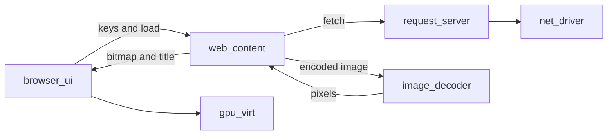

# lerux-ladybird

Last updated: 2026-10-25

**Status:** Milestone 2 has landed. Milestones 3 through 20 have not. Milestones run in order. Implement one milestone per pass, and only after the previous milestone's exit holds. This file is the plan. Milestone 1 adds the library crates. It adds no protection domain and no continuous-integration job. Milestone 2 parses an `https` URL in `lerux-ladybird-url`.

**Goal:** A browser named lerux-ladybird, written in Rust, `#![no_std]` plus `alloc`, that runs as lerux protection domains. Its process split and its path from a load to pixels follow [Ladybird](https://github.com/LadybirdBrowser/ladybird). The code is written in this tree.

**Architecture:** Ladybird splits the browser into separate processes and builds a page through a fixed pipeline: fetch, HTML parse, CSS object model, style, a layout tree that is separate from the document, a paintable tree, stacking contexts, then paint. JavaScript is a sibling library: lexer, parser, abstract syntax tree, bytecode, then a garbage-collected interpreter. lerux keeps that split. Microkit's protection-domain set is static, so each Ladybird process that this plan includes is one protection domain, created at boot.

Upstream documents and directories below are the reference for the milestone that names them. Read that document before editing. A developer machine may also have a checkout at `/home/julian/repos/github_orgs/LadybirdBrowser/ladybird`. That checkout stays outside this repo. So do the upstream sources. Nothing from either tree is copied into git.

The live browser smoke stays `just test-browser-sddf`. It uses `lerux-html` and `lerux-web`. This tree does not depend on those crates and does not grow them. [`docs/desk-browser.md`](../docs/desk-browser.md) stays the metal-boot spec. Milestone 20 names the seam and does not implement that spec.

Related: [`docs/plan-interactive.md`](../docs/plan-interactive.md) (phases 71–80, the earlier Ladybird-shaped protection domains), [`docs/plan-lionsos.md`](../docs/plan-lionsos.md) milestones 12 and 18 (the live graphics smoke), [ADR-009](../docs/decisions/009-interactive-surface.md), [ADR-012](../docs/decisions/012-ordinary-webassembly.md).

## What Ladybird is today

Read from the upstream tree while this plan was written.

Services, from `Services/CMakeLists.txt` and `UI/`:

- `UI/` is the browser chrome.
- `Services/WebContent` hosts the engine and paints a shared bitmap.
- `Services/RequestServer` performs the network loads.
- `Services/ImageDecoder` decodes images.
- `Services/WebWorker` runs a worker.
- Also present, and out of scope here: Compositor, AudioServer, MediaServer, VideoDecoderServer, WebDriver.

Libraries, from `Libraries/CMakeLists.txt`:

- `Libraries/LibURL`, `Libraries/LibGfx`, `Libraries/LibHTTP`, `Libraries/LibRequests`, `Libraries/LibTextCodec`, `Libraries/LibUnicode`.
- `Libraries/LibWeb` is the document engine. Its Rust sources under `Libraries/LibWeb/Rust/src` are the modules `css`, `layout`, `painting`, `paint_stage`, `render_state`, `stage`, and `svg`. The HTML tokenizer is the separate crate `libweb_html_tokenizer`.
- `Libraries/LibJS` is the script engine. `Libraries/LibJS/Rust/src/lib.rs` describes the stages: UTF-16 source, lexer, parser, abstract syntax tree, bytecode, then the runtime. The garbage collector is LibGC.
- `Libraries/LibWasm` executes WebAssembly. `Libraries/LibImageDecoders` decodes bitmaps.

Documents an implementer opens by name:

- [Documentation/ProcessArchitecture.md](https://github.com/LadybirdBrowser/ladybird/blob/master/Documentation/ProcessArchitecture.md). WebContent hosts LibWeb and LibJS, paints a shared bitmap, and reaches the network only through RequestServer. ImageDecoder decodes one image in a fresh process. Processes are spawned through a session socket.
- [Documentation/LibWebFromLoadingToPainting.md](https://github.com/LadybirdBrowser/ladybird/blob/master/Documentation/LibWebFromLoadingToPainting.md). Load, HTML parse, CSS object model, style, layout tree, paintable tree, stacking contexts, paint phases.
- [Documentation/Style/StyleEngine.md](https://github.com/LadybirdBrowser/ladybird/blob/master/Documentation/Style/StyleEngine.md). The cold exact evaluator is the reference. Incremental style has to match it, so the cold evaluator comes first.
- [Documentation/BrowsingContextsAndNavigables.md](https://github.com/LadybirdBrowser/ladybird/blob/master/Documentation/BrowsingContextsAndNavigables.md).
- [Documentation/EventLoop.md](https://github.com/LadybirdBrowser/ladybird/blob/master/Documentation/EventLoop.md). This is LibCore's loop. It is a different object from the HTML event loop.
- [Documentation/Omnibox.md](https://github.com/LadybirdBrowser/ladybird/blob/master/Documentation/Omnibox.md).

## Process map

Ladybird spawns WebContent, RequestServer, and ImageDecoder on demand. Microkit cannot spawn, so this image has one of each. Ladybird starts a fresh ImageDecoder process per image. The one `image_decoder` protection domain decodes one image and returns to idle, which is the same sandbox boundary without a spawn. Ladybird's LookupServer is a separate service. Name lookup lives inside `request_server` until a second client needs its own protection domain. Ladybird frames (`iframe`) stay inside WebContent. They are not extra protection domains.

`gpu_virt` remains the present path, the same virtio graphics client queues the browser image already uses. Ladybird's Compositor and LibCompositing stay out. `web_content` maps neither the network device nor the graphics device. `browser_ui` maps the graphics client regions and the serial client regions. It does not map virtio memory-mapped input/output.

## Library map

| Ladybird | Crate in this tree | Who links it |
| --- | --- | --- |
| `Libraries/LibURL` | `lerux-ladybird-url` | `lerux-ladybird-web`, later `request-server` |
| `Libraries/LibGfx` | `lerux-ladybird-gfx` | `web-content` and `browser-ui`. The shared bitmap header lives here so the chrome does not link the engine |
| `libweb_html_tokenizer` and the DOM | `lerux-ladybird-html` | `lerux-ladybird-web` |
| `Libraries/LibWeb` | `lerux-ladybird-web` | `web-content` only |
| `Libraries/LibHTTP` and `Libraries/LibRequests` | `lerux-ladybird-http` | `web-content` and `request-server` |
| `Libraries/LibJS` | `lerux-ladybird-js` | `web-content`, from milestone 13 |
| `Libraries/LibImageDecoders` | `lerux-ladybird-image` | `image-decoder` and `web-content` |
| `Libraries/LibWasm` | existing `lerux-wasm` | `web-content`, from milestone 18 |

Paths:

- Libraries: `lerux-ladybird/crates/<crate>/`
- Protection domains: `lerux-ladybird/pds/<name>/`
- Microkit names use underscores: `browser_ui`, `web_content`, `request_server`, `image_decoder`, `web_worker`.
- Program names use hyphens: `sddf-browser-ui.elf`, `sddf-web-content.elf`, `sddf-request-server.elf`, `sddf-image-decoder.elf`, `sddf-web-worker.elf`.

`lerux-ladybird-web` modules follow `Libraries/LibWeb/Rust/src`: `dom` is supplied by `lerux-ladybird-html`; inside the web crate the modules are `css`, `style`, `layout`, `painting`, `page`, and `fetch`. `svg` waits until a milestone adds it.

LibJS source in Ladybird is UTF-16. The stage order is what this tree copies. Source text in `lerux-ladybird-js` is Unicode scalar values until a milestone needs UTF-16 code units.

LibCore's event loop waits on file descriptors. The Microkit analogue is the root protection-domain thread waiting on notifications, which is already how `lerux-cothread` runs. The HTML task queue is a different object and arrives in milestone 14.

## Rules

These hold for every milestone.

- Every library and every protection domain is `#![no_std]` and may use `alloc`. Host tests enable `std` only under `cfg(test)`, the same pattern as `userspace/crates/lerux-html`. Edition 2024, license MIT, `[lints] workspace = true`.
- A library may depend on other `lerux-ladybird-*` crates, and on the workspace crates `heapless` and `log` with their default features off.
- A protection domain may also depend on `sel4-microkit`, `lerux-sddf`, and `lerux-cothread`. `request-server` may depend on `lerux-tls`. `web-content` may depend on `lerux-wasm` only in milestone 18, with the existing `wasmi` features `validate`, `prefer-btree-collections`, and `portable-dispatch`.
- `browser-ui` depends on `lerux-ladybird-gfx`. It does not depend on `lerux-ladybird-web`, `lerux-ladybird-html`, or `lerux-ladybird-js`.
- No new crates.io crate and no new git dependency. In particular the tree does not add `html5ever`, `cssparser`, `taffy`, Servo, `boa`, `rquickjs`, `image`, `png`, `flate2`, `fontdue`, the `url` crate, `idna`, or `regex`. PNG inflate, the font, and the URL parser are written in this tree.
- This tree does not depend on `lerux-html` or `lerux-web`. It does not add `lerux-logging` or `lerux-interface-types`. Smoke lines are written by the protection domain that owns the serial client.
- Shared pages are `#[repr(C)]`. Fill one by zeroing it, then assigning fields. Notify the other end on a channel. The page types live in this tree. LionsOS has no browser header, so they are not added to `lerux-sddf`. Postcard messages are not added.
- This image follows the other device-framework images. Channel identifiers live in the system template and in the configuration struct the protection domain reads. A number that the template does not contain is a bug. When the board has a profile, `lerux profile check-channels` is the check.
- One `web_content`. The root holds assertions. A cothread does not panic. The protection-domain stack attribute stays `0x10_000`.
- The HTML subset is named in `lerux-ladybird-html` and widens only when a milestone says so. The parser is a tokenizer plus insertion modes, so a new tag is a new state in that parser.
- Host milestones exit on `cargo test -p <crate>`. From milestone 1 onward, `just check` names the new libraries. From milestone 9 onward, the milestone also passes `just check-pd` and `just test-ladybird`. `just test-browser-sddf` keeps passing. The workflow `include` list and the smoke counts in `docs/ci.md` and the README move together, and only after that milestone's smoke has passed.
- `cargo fmt --all --check` covers this tree once the crates are workspace members. Milestone 1 is the one that adds the members.

The first bitmap has to paint the tags in [`support/browser/fixture.html`](../support/browser/fixture.html): `html`, `head`, `body`, `title`, and `p`. The user-agent sheet hides `head` and `title` and lays the paragraph out as a block. That sheet lives in `lerux-ladybird-web` once milestone 6 writes it. The frame is 320 by 64. Bytes are tightly packed, stride `320 * 4`, little-endian B, G, R, A, with alpha set to `0xff` before the sample. The sample is the first pixel that is not opaque white, in row-major order. The serial line is `pixel ` , eight lowercase hex digits, and a newline. For this fixture that line is `pixel 000000ff`.

## Milestone 1 — Tree and Page

**Ladybird:** `Libraries/CMakeLists.txt`, and the class overview in `Documentation/ProcessArchitecture.md`. A `Page` hosts a `Document`.

**Exit:** The seven library crates exist, `lerux-ladybird-web` exposes a `Page` that owns one empty `Document`, and `cargo test -p lerux-ladybird-web` constructs that page. `just check` passes. No protection domain is added.

- Create `lerux-ladybird/crates/` with `lerux-ladybird-url`, `lerux-ladybird-gfx`, `lerux-ladybird-html`, `lerux-ladybird-web`, `lerux-ladybird-http`, `lerux-ladybird-js`, and `lerux-ladybird-image`.
- Add those paths to the workspace `members` list in the root `Cargo.toml`.
- Add the same crate names to the `just check` clippy line and the `just check` test line, and to `SHARED_CRATES` in `tools/lerux-cli/src/clippy.rs`.
- Each crate's crate-level comment names the Ladybird library it stands in for.
- `Page` lives in `lerux-ladybird-web` and owns one `Document`. `Document` lives in `lerux-ladybird-html`. The document has a root and no elements yet.
- Add a row for this file to the index table in `docs/README.md`.

Out of scope: parsers, bitmaps, protection domains, a board.

## Milestone 2 — URL

**Ladybird:** `Libraries/LibURL`.

**Exit:** `cargo test -p lerux-ladybird-url` parses an `https` URL, resolves a relative reference against a base, and builds a request target that omits the fragment.

- Support scheme, host, port, path, query, and fragment. An omitted port for `https` is 443.
- A relative reference resolves against a base URL. The fragment is kept on the URL value and left off the request target.
- No sockets. `lerux-ladybird-url` does not depend on `lerux-tls` or `smoltcp`.

Out of scope: public suffixes, Internationalized Domain Names, and `http` as an accepted navigation scheme. The parser may still recognize the scheme text so a later milestone can reject it.

## Milestone 3 — Bitmap

**Ladybird:** `Libraries/LibGfx`.

**Exit:** `cargo test -p lerux-ladybird-gfx` fills a rectangle and paints one glyph whose first non-white pixel matches a fixed sample.

- The buffer is the frame described in the rules: 320 by 64, tightly packed, little-endian B, G, R, A.
- Operations used by later paint: fill a rectangle, blit a rectangle, set one pixel, sample the first non-white pixel.
- The font is a built-in bitmap font written in this crate. The glyph set covers the fixture text `lerux` and `lerux-http-fixture`.
- The shared control page is declared here as `#[repr(C)]`: a state, a title length, and a title buffer. The bitmap is a separate region, sized to the frame (`320 * 64 * 4` bytes). `browser-ui` and `web-content` will both map those regions. Milestone 9 is the first one that maps them.

Out of scope: scaling, paths, and image formats.

## Milestone 4 — DOM and HTML

**Ladybird:** the `libweb_html_tokenizer` crate, and the HTML section of `Documentation/LibWebFromLoadingToPainting.md`.

**Exit:** `cargo test -p lerux-ladybird-html` parses [`support/browser/fixture.html`](../support/browser/fixture.html) into a document whose title text is `lerux`.

- The tokenizer and the tree builder are separate types. The tree builder drives the tokenizer.
- Nodes are a document, elements, and text. An element has a tag, a parent, and children.
- Insertion modes cover the fixture: the doctype, `html`, `head`, `title`, `body`, and `p`. `title` is raw text.
- The subset is listed in the crate comment. A tag outside the subset is recorded as an unknown element and still appears in the tree, so a later milestone can give it a real insertion mode without a second parser.

Out of scope: `document.write`, scripting flags, encoding detection. Input is UTF-8.

## Milestone 5 — CSS object model

**Ladybird:** `Libraries/LibWeb/Rust/src/css`, and the CSS section of `Documentation/LibWebFromLoadingToPainting.md`.

**Exit:** `cargo test -p lerux-ladybird-web` parses a style sheet into rules, selectors, and declarations. No computed style yet.

- A style sheet holds rules. A selector is a sequence of compound selectors. A compound selector holds simple selectors: type, class, id. Combinators in this milestone are descendant and child.
- Declarations store a property name and a value. A custom property is stored as an unresolved value.
- Properties the parser accepts: `color`, `background-color`, `font-size`, `display`, `margin`, `padding`, `width`. Any other property is kept as an unknown declaration so a later milestone can resolve it.

Out of scope: the cascade, media queries, and `@import`.

## Milestone 6 — Cold style

**Ladybird:** `Documentation/Style/StyleEngine.md`. The cold exact evaluator is the reference implementation. This milestone is that evaluator.

**Exit:** A host test shows an author class rule overriding the user-agent rule for `color` on one element, and `head` and `title` computing to `display: none`.

- Origins, in order: user-agent, then author. Specificity decides within an origin. Source order breaks a tie.
- The user-agent sheet lives in `lerux-ladybird-web`. It sets `html` and `body` to block, hides `head`, `title`, and `style`, sets `p` to block, and gives `body` an 8px margin and `p` a vertical margin, matching the sheet that places the fixture paragraph on the existing browser frame.
- Computed values for the properties from milestone 5 are stored per element. Custom properties stay unresolved.
- The result is a value a layout pass can read. Incremental invalidation is a later milestone, added only by extending this file.

Out of scope: the StyleEngine dependency graph, selector buckets, and `:has()`.

## Milestone 7 — Layout tree

**Ladybird:** the layout section of `Documentation/LibWebFromLoadingToPainting.md`.

**Exit:** A host test lays out the fixture at 320 by 64 and records the paragraph's line box. The line box top is y=24, the body margin plus the paragraph's top margin. The test asserts positions. Pixels wait for milestone 8.

- A layout box is a different type from a DOM node. `display: none` generates no box.
- The initial containing block is the frame size.
- A block formatting context lays out block children in order and collapses adjacent vertical margins.
- Inline children of a block run in an inline formatting context and produce line boxes. When a block has both inline and block children, the inline children are wrapped in an anonymous block box.
- The fixture paragraph is one block line box under the body margin.

Out of scope: floats, flex, grid, tables, and absolute positioning.

## Milestone 8 — Paint

**Ladybird:** the paintable, stacking context, and painting sections of `Documentation/LibWebFromLoadingToPainting.md`.

**Exit:** `cargo test -p lerux-ladybird-web` paints [`support/browser/fixture.html`](../support/browser/fixture.html) and the sampled line is `pixel 000000ff`.

- After layout, build a paintable tree. A layout box that cannot be visible has no paintable.
- One stacking context, rooted at the initial containing block.
- Paint phases for this milestone: background and border, then text. Text uses the milestone 3 font.
- Hit testing is a function on the paintable tree. For this milestone it may return no target. Milestone 16 is what makes it return a link.
- Alpha is set to `0xff` before the sample. The sample rule is the one in the rules section.

Out of scope: scroll, transforms, and shadows.

## Milestone 9 — Browser and WebContent

**Ladybird:** `Documentation/ProcessArchitecture.md` and `Services/WebContent`. The chrome presents pixels. WebContent paints the shared bitmap and does not own the display.

**Exit:** `just test-ladybird` prints `title lerux` and then `pixel 000000ff`. `web_content` has no network queue in its memory map. `just check`, `just check-pd`, and `just test-browser-sddf` pass.

- Protection domains `lerux-ladybird/pds/browser-ui` and `lerux-ladybird/pds/web-content`, workspace members, programs `sddf-browser-ui.elf` and `sddf-web-content.elf`.
- Board `qemu_virt_aarch64_ladybird`. It reuses the graphics roles of `qemu_virt_aarch64_browser_sddf` (`gpu_driver`, `gpu_virt`, the graphics regions, virtio-gpu at `+0xa00`, interrupt 77) and the serial roles, so the smoke has a log. Block and network roles stay off this board until a later milestone needs them.
- The document bytes are the fixture, baked into `web-content`.
- `web_content` parses, styles, lays out, and paints into the shared bitmap from milestone 3. It writes the title into the control page, sets the painted state, and notifies `browser_ui`.
- `browser_ui` copies the bitmap through the existing graphics client queues and prints the title line and the pixel line on the serial client. It does not parse HTML.
- Priorities follow the browser image: drivers at 4 with budget 4000, virtualisers at 3 with budget 3000, `web_content` at 2 with budget 2000, `browser_ui` at 1 with budget 1000. The period equals the budget. A notify to the higher priority domain runs it before the caller waits, and the channel semaphore keeps the signal.
- Heap on `web_content` is 1 MiB. Its worker stack is `0x4000`. Assertions stay on the root.
- `support/smoke-expects.toml` gains the two lines. `ci` for the board stays false until the workflow `include` list and the counts in `docs/ci.md` and the README are updated in the same change that records a green smoke.
- Add an `AGENTS.md` section for this board, in the same style as the browser-image section, once the smoke is green.

Out of scope: an address line, keyboard input, and any fetch.

## Milestone 10 — RequestServer

**Ladybird:** `Services/RequestServer`, `Libraries/LibHTTP`, `Libraries/LibRequests`. WebContent has no network of its own.

**Exit:** `just test-ladybird` still prints `title lerux` and then `pixel 000000ff`, and the document bytes came from `GET /fixture.html`. The `web_content` memory map still has no network queue. `just test-browser-sddf` passes.

- Protection domain `lerux-ladybird/pds/request-server`, program `sddf-request-server.elf`. It is the network client: the four serial roles stay with `browser_ui`, and the network queues, the client data regions, `smoltcp`, and `lerux-tls` belong to `request_server`.
- The board gains the network roles from `qemu_virt_aarch64_browser_sddf`. Virtio-net stays at `+0xe00`, interrupt 79. The host helper is the same one-shot HTTPS server the fetch smoke uses, on `10.0.2.2` port 8443, with the smoke certificate authority.
- `web_content` writes the URL into a shared request page defined in `lerux-ladybird-http`, notifies `request_server`, and waits. `request_server` performs one GET, writes the body into a shared region of 64 KiB, sets the length and a status, and notifies back. A body that does not fit sets an error status and a length of 0.
- Priority of `request_server` is 2, beside `web_content`. `browser_ui` stays at 1.
- `net_buffers_init` runs once, on the transmit free queue, with base 0, on the root of `request_server`, before its worker starts. The receive free queue is left alone.
- The baked fixture in `web_content` is removed in this milestone. The smoke loads the URL.

Out of scope: public Domain Name System, redirects, cookies, and a second request in flight. Ladybird's LookupServer stays a function inside this protection domain until a second client exists.

## Milestone 11 — Navigables

**Ladybird:** `Documentation/BrowsingContextsAndNavigables.md`. A page has a top-level navigable. A frame is a child navigable inside the same WebContent process.

**Exit:** A host test loads a document, follows one link to a second document, and follows a fragment without a second load. `just test-ladybird` still prints `title lerux` and `pixel 000000ff` for the fixture, then paints a second document that contains one link and one `iframe`. The iframe's fetched pixels change the next sampled line. Link activation on the guest waits for milestone 16.

- One top-level navigable on the `Page`. Navigating replaces the document. There is no back stack.
- A link with no host resolves against the current document's URL from milestone 2. A link that only changes the fragment updates the URL and scrolls. It does not call `request_server`.
- One child navigable for a single `iframe`. The child document is fetched through the same request page, sequentially, after the parent. The child paints inside the parent's content box.
- The guest fixture is a new file under `support/browser/`, small enough to fit the 64 KiB body region. It contains one link and one `iframe`. The iframe is the first painted content, so the first non-white pixel belongs to the child. After the fixture lines, `web_content` loads this URL on its own. The address line does not exist yet. Milestone 16 replaces that baked load with a typed one.

Out of scope: `target` that would open a new tab, and nested iframes past one child.

## Milestone 12 — ImageDecoder

**Ladybird:** `Services/ImageDecoder` and `Libraries/LibImageDecoders`. Each image is decoded outside WebContent.

**Exit:** A host test decodes a baked non-interlaced PNG into known pixels. `just test-ladybird` paints a document whose `img` is that PNG, and the sampled pixel is the pixel the test names.

- Protection domain `lerux-ladybird/pds/image-decoder`, program `sddf-image-decoder.elf`. Priority 2.
- `web_content` sends the encoded bytes and waits. `image_decoder` decodes one image, writes pixels back, notifies, and returns to idle before accepting another. A second image waits until that idle state.
- The decoder accepts an 8-bit, non-interlaced PNG with one image header and one data chunk, RGB or RGBA. Inflate is written in `lerux-ladybird-image`.
- The `img` element generates a replaced box. The paintable blits the returned pixels. An unsupported image leaves the box empty and the rest of the page paints.

Out of scope: JPEG, animated PNG, and interlacing.

## Milestone 13 — Script engine

**Ladybird:** `Libraries/LibJS/Rust/src/lib.rs`. Stages: lexer, parser, abstract syntax tree, bytecode, runtime on a garbage-collected heap.

**Exit:** `cargo test -p lerux-ladybird-js` runs a function that branches and returns an integer. The test does not link `lerux-ladybird-web`.

- Lexer over Unicode scalar values. Parser is recursive descent with precedence climbing. It builds an abstract syntax tree, then a bytecode compiler walks that tree.
- The interpreter is a stack machine with a mark-and-sweep heap. Values in this milestone: undefined, boolean, number, string, and ordinary objects.
- Language subset: literals, arithmetic, `let`, `function`, `if`, and calls. A syntax error returns an error to the caller. The engine does not panic on guest script.
- The Ladybird bytecode generator and its interpreter are a reference for the stages. The opcodes in this crate are the ones this subset needs.

Out of scope: prototypes beyond what a call requires, `eval`, modules, promises, and any DOM object.

## Milestone 14 — Classic scripts

**Ladybird:** the HTML event loop, which `Documentation/EventLoop.md` distinguishes from LibCore. A classic script runs as part of parsing the document that contains it.

**Exit:** A host test parses a document with one `<script>`, runs it after the tree is built, and reads back a value the script stored on a test hook. No pixels.

- `<script>` without `src` is raw text, the same way `title` is. The element is in the milestone 4 subset from this milestone onward.
- The HTML task queue is one queue of tasks, drained by the `web_content` worker. It is not the Microkit notification pump. The root still owns notifications and forwards them to that worker.
- The script runs to completion before paint. A throw leaves the document in place and records a script error on the control page. `browser_ui` prints `script err` and still presents the bitmap.
- `document.write` is not implemented. The parser does not accept injected input.

Out of scope: external scripts, modules, `defer`, `async`, and microtasks.

## Milestone 15 — DOM bindings

**Ladybird:** `Meta/Generators/libweb_bindings`, which generates bindings from WebIDL. This tree writes the subset by hand.

**Exit:** A host test runs a script that sets an element's text, flushes style and paint, and sees a new sampled pixel. `just test-ladybird` loads a fixture with that script and prints the new pixel line.

- Bound names: `document`, element objects, `title`, `getElementById`, and setting `textContent` on an element.
- After the script, style and layout run again, then paint. The control page carries the new title if the script changed it.
- Bindings are functions in `lerux-ladybird-web` that call `lerux-ladybird-js`. The script engine stays free of HTML types. The host object is a callback the web crate registers.
- Heap on `web_content` becomes 2 MiB in this milestone. The worker stack becomes `0x1_0000`.

Out of scope: the rest of the DOM, events as a script API, and generated bindings.

## Milestone 16 — Chrome and keys

**Ladybird:** the Browser process in `Documentation/ProcessArchitecture.md`, and `Documentation/Omnibox.md`. The chrome owns the address line and forwards input. WebContent hit-tests.

**Exit:** `just test-ladybird` still prints `title lerux` and `pixel 000000ff` for the first paint. It then types an address over the serial port, loads that URL through `request_server`, and prints the new pixel line. A further serial step focuses a link and activates it with Enter.

- `browser_ui` paints an address line above the page bitmap. The page bitmap stays 320 by 64. The line is 16 extra rows in the graphics client buffer, painted by `browser_ui`. `web_content` keeps painting only the 320 by 64 page. The graphics client data region grows by those 16 rows (`320 * 16 * 4` bytes) so the copy has a place to land. The scanout height grows with it. QEMU's minimum scanout side is 16, and 80 is above that.
- Keys arrive on the serial client, which `browser_ui` already owns. While the line is focused, printable characters, Backspace, and Enter edit and submit it. Enter on a non-empty line replaces the navigable via the milestone 10 request page.
- Keys for the page are forwarded to `web_content`. Hit testing returns the link under the focused target. Enter activates it. Milestone 11's navigation rules apply.
- The smoke sends those bytes on the guest serial port after the ready line. It does not send a mouse event.

Out of scope: a tab strip, buttons, and pointer input.

## Milestone 17 — Forms

**Ladybird:** HTML form submission, as a navigation on the same top-level navigable.

**Exit:** A host test builds the query string for a GET form. `just test-ladybird` submits that form and the following pixel line is the response document.

- The form's action resolves with `lerux-ladybird-url`. An empty action is the current document's URL.
- A GET form puts the fields in the query and navigates under the milestone 11 rules. The address line shows the URL that will be loaded.
- One text control and one submit control are enough for the smoke. Tab moves focus from the link or control to the next, wrapping at the ends.

Out of scope: POST, file inputs, and a password field that accepts keys.

## Milestone 18 — WebAssembly

**Ladybird:** `Libraries/LibWasm`, and the WebAssembly bindings under `Libraries/LibWeb`.

**Exit:** Before any call into `wasmi`, this milestone records in this file whether a module that arrived in a page must be signed. The smoke then matches that record. The program image's signature check is unchanged.

- The two choices to record: require a signature, as `qemu_virt_aarch64_program_sddf` does, or accept the page's bytes because `web_content` is already the sandbox. Write the choice and the reason into this milestone's status notes.
- Execution goes through `lerux-wasm` and the `wasmi` features named in the rules. `web_content` does not gain a second engine.
- A script in the subset can instantiate one module and call one exported function. The host test checks the return value. The guest smoke prints a pixel or a serial line that depends on that return value.
- Module bytes come from the document, either baked beside the script or fetched through `request_server`. They are not read from the filesystem.

Out of scope: threads, SIMD, and memory64. Those feature flags stay off.

## Milestone 19 — One worker

**Ladybird:** `Services/WebWorker`. Ladybird spawns a worker when the page asks. This image has one slot.

**Exit:** A host test posts a byte string to the worker and reads the same bytes back. `just test-ladybird` runs a document that does this and prints `worker ok`.

- Protection domain `lerux-ladybird/pds/web-worker`, program `sddf-web-worker.elf`. Priority 2. It links `lerux-ladybird-js` and does not link `lerux-ladybird-web`.
- `postMessage` in this milestone carries a byte string. The worker posts a byte string back. One message at a time, on a shared page, with a notify in each direction.
- A second `Worker` constructor while the slot is busy fails the script. The page stays up.
- The worker has no request page and no bitmap.

Out of scope: structured clone, shared memory, and a worker that fetches.

## Milestone 20 — Desk seam

**Ladybird:** the same process split. The desk document is [`docs/desk-browser.md`](../docs/desk-browser.md). Scanout is [ADR-013](../docs/decisions/013-desk-intel-scanout.md). The QEMU decision is [ADR-009](../docs/decisions/009-interactive-surface.md).

**Exit:** This file names `browser_ui` as the protection domain that would map the desk framebuffer, and `request_server` as the protection domain that would speak to a future onboard Ethernet driver. No new protection domain is added. `just test-ladybird` still passes.

- State the seam in this milestone's notes: the page bitmap remains the one `web_content` paints; `browser_ui` would copy it into the firmware framebuffer on the desk, the way it copies into the graphics client buffer on QEMU.
- `request_server` remains the only fetcher. A desk driver would sit where `net_driver` sits on this QEMU board.
- Leave [`docs/desk-browser.md`](../docs/desk-browser.md) as it stands. A later edit may point that spec at these protection domains after `just test-ladybird` is the smoke the spec should name. That edit is a separate change.

Out of scope: the Ethernet driver, programming the Intel display engine, and a metal boot.

## Out of scope

Audio, video, WebDriver, a GPU compositor, extra tabs, incremental style, `document.write`, POST, public Domain Name System, and the desk Ethernet driver. Each of those becomes work only by adding a milestone to this file.
